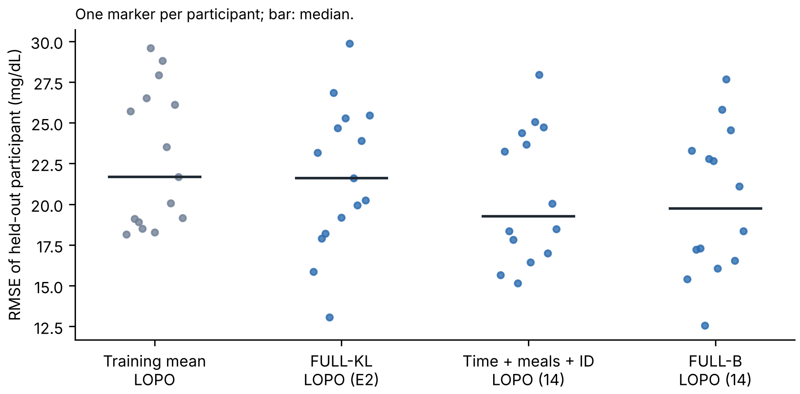
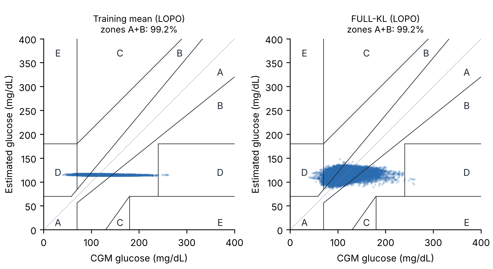
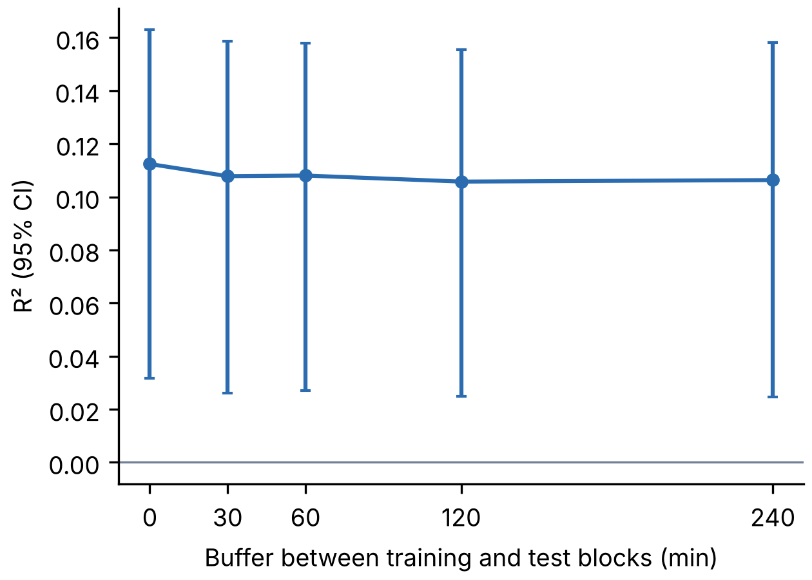
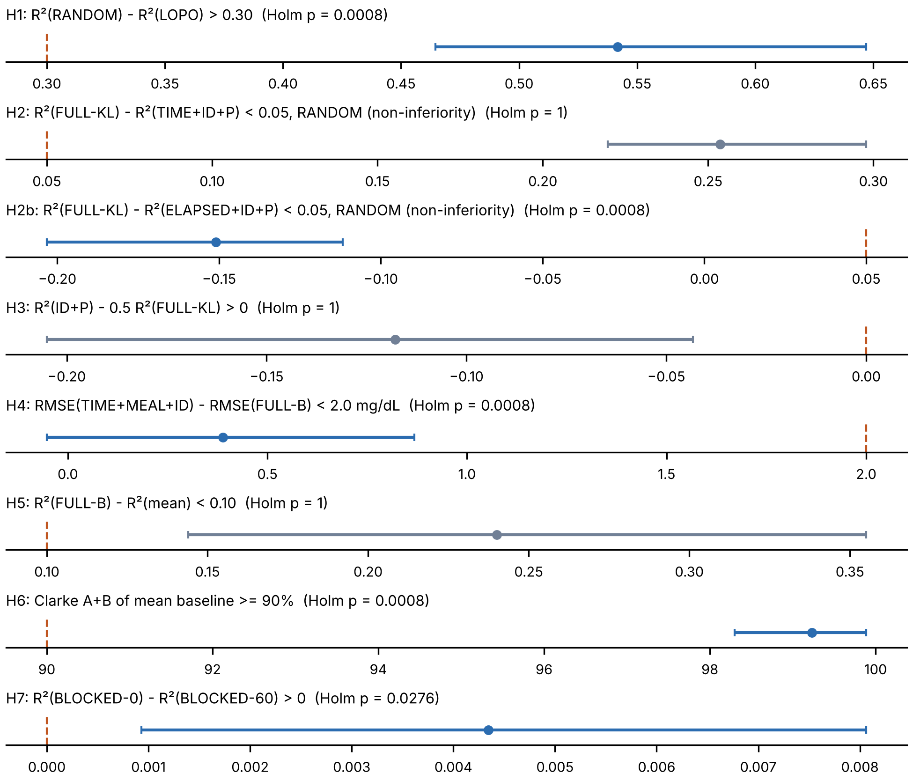
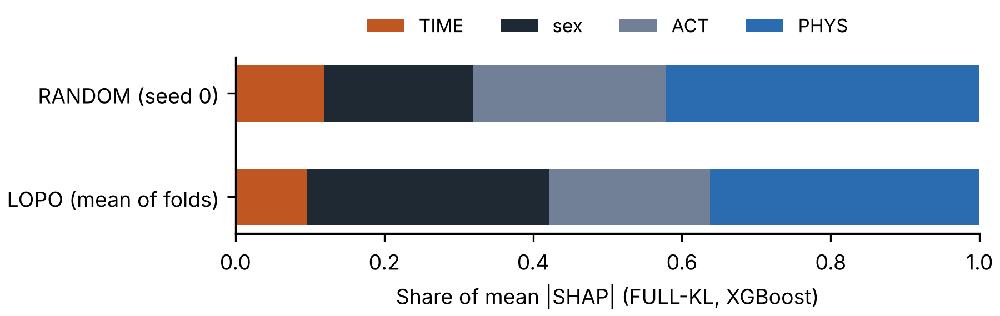

<!--
Authoring rules for this file
- Every number in Sections 3-5 must be copied from a file under results/ that a script wrote.
- [RESULT: ...] marked text that depended on the registered analyses; all were filled on 22 Nov 2026 after the registration was approved.
- Citations use [@key] from references/references.bib; all keys were checked against Crossref or arXiv on 22 Nov 2026.
- The text is written new for this paper. Methods shared with Abu Owida et al. (2026) are described in new words and cited, not copied.
-->

<!-- Author order from M. Banat, 22 Nov 2026. Names and affiliations copied from
Abu Owida et al., Sensors 2026, 26(22), 7340 (doi 10.3390/s26227340), where all
five authors appear; checked against that article's PDF (first page) on 22 Nov 2026.
ORCIDs are from the same PDF. Re-check each affiliation with its author before
submission. E-mail addresses are kept out of this public repository. -->

**Authors:** Mohannad Banat ^1,\*^, Hamza Abu Owida ^1^, Ayoub Alsarhan ^2^, Dimah Al-Fraihat ^3^ and Abdulmohsen Algarni ^4,\*^

^1^ Department of Medical Engineering, Faculty of Engineering, Al-Ahliyya Amman University, Amman 19328, Jordan

^2^ Department of Information Technology, Faculty of Prince Al-Hussien bin Abdullah, The Hashemite University, Zarqa 13133, Jordan

^3^ Department of Software Engineering, Faculty of Information Technology, Isra University, Amman 11622, Jordan

^4^ Department of Computer Science, King Khalid University, Abha 61421, Saudi Arabia

**ORCID:** M. Banat 0009-0007-1413-4746; H. Abu Owida 0000-0001-6943-6134; A. Alsarhan 0000-0001-9075-2828; D. Al-Fraihat 0000-0002-0993-8287; A. Algarni 0000-0002-7556-958X

\* Correspondence: Mohannad Banat (M.B.) and Abdulmohsen Algarni (A.Alg.). [E-mail addresses are added only in the submission file, not in this public repository.]

## Highlights

### What are the main findings?
- Under a random split of readings, a model given only participant identity and elapsed recording time (R² 0.76) outperformed a re-implemented wrist-physiology model (R² 0.61).
- Held out by participant, wrist physiology explained almost no glucose variance (R² 0.07) and improved RMSE by 0.4 mg/dL beyond time, meals and HbA1c.

### What are the implications of the main findings?
- Random-split R² and the Clarke A + B percentage (99.2% for a constant prediction) are not evidence that wrist wearables estimate glucose.
- Glucose estimation from wearables should be validated on unseen participants against shortcut-only and constant baselines, under a registered plan.

## Abstract

Wrist-worn wearables are often reported to estimate interstitial glucose
accurately, but most reports validate on random splits of readings, so the
same people and hours appear in training and test data. We re-evaluated
glucose estimation on the public BIG IDEAs dataset (Dexcom G6 and Empatica
E4; 15 of 16 adults analysed) under an analysis plan registered before any
model was trained. Under the published random 80/20 split, our
re-implementation of a published model reached R² = 0.61 (95% CI 0.54–0.66;
published 0.73). A model given only participant identity and the time
elapsed since the start of the recording reached R² = 0.76 (0.72–0.80).
Holding participants out reduced the physiology model's R² to 0.07 (−0.06
to 0.16). When time of day, meals, sex and HbA1c were known, wrist
physiology and activity improved the root mean squared error by 0.39 mg/dL
(−0.05 to 0.87). A constant prediction placed 99.2% of readings in Clarke
zones A and B, as did every model. On these data, random-split accuracy
reflects interpolation within each recording, not information carried by
wrist signals. Glucose estimation from wearables should be validated on
participants the model has not seen and compared against shortcut-only and
constant baselines.

**Keywords:** continuous glucose monitoring; wearable sensors; data leakage;
shortcut learning; cross-validation; Empatica E4; pre-registration;
reproducibility

## 1. Introduction

Continuous glucose monitors (CGMs) measure interstitial glucose through a
filament under the skin. The sensors must be replaced every week or two, and
their cost limits use outside diabetes care. Wrist-worn devices that record
heart rate, skin temperature, electrodermal activity (EDA) and movement are
cheaper and non-invasive. Several studies have therefore asked whether
these signals can stand in for a CGM, at least among people with
high-normal glucose or prediabetes, for whom early feedback could support
lifestyle change [@bent_digital_2021; @dunn_wearables_2021].

The publicly available BIG IDEAs dataset made this question testable
[@cho_bigideas_2026; @pollard_physionet_2026]. It pairs a Dexcom G6 CGM with
an Empatica E4 wristband and a food log for 16 adults over 8–10 days of
ordinary life. The dataset authors predicted CGM glucose with a
gradient-boosted model evaluated by leave-one-person-out cross-validation
(LOPO) and reported a root mean squared error (RMSE) of 21.22 ± 4.14 mg/dL
[@bent_digital_2021]. More than a third of the model's feature importance
came from the food log, and a further 10.8% from user-entered variables
such as sex and HbA1c [@bent_digital_2021]. A later study in *Sensors*
removed food logs and used only passively recorded signals, circadian
features and biological sex. It reported R² = 0.73, an RMSE of 11.9 mg/dL
and 99.4% of predictions in Clarke zones A and B
[@karunarathna_glucose_2025]. That study evaluated its models on "an 80/20
train–test split" of 26,380 five-minute epochs, repeated over 20 random
seeds, and does not state whether participants were kept apart. Its most
important feature was biological sex [@karunarathna_glucose_2025].

The two results differ by almost a factor of two in RMSE, and the
difference matters. If readings are split at random, the test set holds
readings taken minutes before or after training readings from the same
person. Clinical machine learning has long warned that such record-wise
splits overstate how well a model works for a new person
[@saeb_usecase_2017; @little_cv_2017]. Leakage between training and test
data is now recognised as a common cause of irreproducible results across
fields that use machine learning [@kapoor_leakage_2023]. A related problem
is shortcut learning, in which a model reaches high accuracy through a cue
that is correlated with the target in the data but is not the mechanism of
interest [@geirhos_shortcut_2020]. Two shortcuts are plausible in wearable
glucose data. With 16 people, sex and a few slowly varying signals can
nearly identify the person, and person-level mean glucose then explains
part of the variance. Clock time carries the daily rhythm of meals, which
drives much of the variation in glucose.

Ramesh et al. recently re-assessed estimation of glucose from
photoplethysmography (PPG) on two clinical datasets. Models that looked
competitive under random window-level splits fell to an R² near or below
zero when participants were held out. In every model and split, including
a constant mean prediction, more than 90% of predictions fell in Clarke
zones A and B [@ramesh_reassessing_2026]. Their study did not use BIG
IDEAs, free-living multimodal wrist data, leave-one-participant-out
evaluation, controls for time or identity, or a registered analysis plan.
Reproducibility problems have also been documented for deep-learning
forecasting of glucose from past CGM values in type 1 diabetes, which is a
different task from estimation [@lu_reproducibility_2026]. In earlier work,
our group used a pre-registered design with explicit shortcut controls to
show that a wearable stress detector raised alarms through most exercise
sessions [@abuowida_stress_2026]. Here we apply the same discipline to
glucose estimation.

This paper makes four contributions. (i) It is a participant-level
re-evaluation of glucose estimation on BIG IDEAs, with the analysis plan
registered before any model was trained [https://doi.org/10.17605/OSF.IO/CVFA3]. (ii) It tests
shortcut-only models: clock time alone, elapsed time with participant
identity, and identity alone. We found no such controls in the published
work on this dataset. (iii) It measures what wrist physiology adds to time,
meal and demographic information when participants are held out. (iv) It
reports a data-quality check that is a precondition for meal-based
features: in the current release, the food logs of two participants do not
line up with their CGM recordings. We do not claim to be the first to show
that random splits inflate estimates of glucose from wearables. Ramesh et
al. showed this for clinical PPG [@ramesh_reassessing_2026]. Our
contribution is to identify *what* the inflated models use, in free-living
multimodal data, under a registered plan.

## 2. Materials and Methods

The analysis plan, including hypotheses, margins, exclusions, models and
statistics, was registered on the Open Science Framework (OSF) on 22
November 2026 (https://doi.org/10.17605/OSF.IO/CVFA3) before any model was
fitted to glucose. The analysis code was deposited with the registration,
and the code that produced the results is byte-identical to it (SHA-256
`dea04bc3…5333182b`). Section 2.9 lists what the authors
had seen before registration. Deviations are reported in Appendix B.

### 2.1. Dataset

We used version 1.1.3 of the BIG IDEAs Lab Glycemic Variability and
Wearable Device Data [@cho_bigideas_2026], which is openly available on
PhysioNet [@pollard_physionet_2026] under the Open Data Commons Attribution
licence. Sixteen adults aged 35–65 years with high-normal glucose or
prediabetes wore a Dexcom G6 CGM and an Empatica E4 wristband for 8–10 days
and logged their food intake [@bent_digital_2021]. The CGM reports
interstitial glucose every 5 min. The E4 records blood volume pulse (BVP)
at 64 Hz, EDA and skin temperature at 4 Hz, and three-axis acceleration
(ACC) at 32 Hz. It also derives heart rate (HR) at 1 Hz and inter-beat
intervals (IBI) on the device. `Demographics.csv` lists 9 female and 7 male
participants, with HbA1c between 5.3% and 6.4%. PhysioNet shifts all dates
to protect identity. Version 1.1.3 differs from version 1.1.2 only in four
food-log files (participants 007, 013, 015 and 016). The E4 and Dexcom files
of the two versions are byte-identical (comparison of the published SHA-256
checksums), so the E4 files were taken from the PhysioNet mirror of v1.1.2
and verified against the v1.1.3 checksums. The study by Karunarathna and
Liang used v1.1.2 [@karunarathna_glucose_2025].

### 2.2. Food-Log and CGM Alignment Check

Meal-based features are valid only if the food log and the CGM share a
clock. Before registration we therefore tested, for each participant,
whether logged meals are followed by a rise in glucose. Food entries
within 30 min of each other were merged into one meal event, and events
with less than 10 g of carbohydrate were ignored. For each event we
computed the *meal rise*: the highest glucose value in the 2 h after the
logged time minus the mean glucose in the 15 min before it. A participant
passed if four conditions held. (a) At least 80% of meal events fell inside
the CGM recording. (b) The mean meal rise exceeded that at random times in
the same recording (2000 permutations, p < 0.05). (c) Shifting all meal
times by whole days (−21 to +21 days) did not give a larger mean rise than
a shift of zero. Only shifts that kept at least half the events were
compared. (d) The best shift within ±12 h was within 60 min of zero.

Fourteen participants passed (Figure 1). For them, the mean meal rise was
28.8–47.1 mg/dL, against 11.8–22.3 mg/dL at random times, and the best
shift lay between −30 and +15 min. Two participants failed. For participant
015, the food log covers 5–13 July (shifted dates) while the CGM covers
19–27 July, so no logged meal falls inside the recording. For participant
016, the rise at logged meals (19.6 mg/dL) did not differ from that at
random times (19.1 mg/dL; p = 0.45). Its largest rise came from a shift of
−3 h, but the offset could not be confirmed, so it was not corrected.
Meal-based features were therefore registered for the 14 aligned
participants only (Section 2.4).

The same check, run on the version 1.1.2 food logs of the four participants
whose logs changed in version 1.1.3, explains the problem. In version
1.1.2, none of these four logs overlapped its CGM recording: each began
about 5 months before the CGM data. Their version 1.1.1 files are
byte-identical to version 1.1.2. Version 1.1.3 fully realigned 007 and 013.
It moved 016 into the recording window, but with no detectable meal
response, and it left 015 outside the window
(`results/food_log_versions/`). Miyakoshi and Ito related postprandial
glucose to logged nutrients using version 1.1.1 [@miyakoshi_glucose_2024].
For four of the 16 participants, that version's food logs did not overlap
the CGM data at all.

Clock time itself appears preserved by the date shift. In 15 of 16 participants, the first food entry of the day falls
between 05:00 and 11:00 (median per participant). The exception,
participant 010, logs the same breakfast at about 04:30 on six days, and
the CGM confirms meals at those times.

### 2.3. Pre-Processing and Exclusions

Each CGM reading is one sample, and its value in mg/dL is the target. CGM
values from earlier times were never used as inputs, which keeps the task
one of estimation rather than forecasting. We excluded the first 2 h of
each CGM record, and the first 2 h after any gap longer than 2 h, to remove
sensor warm-up. Following Karunarathna and Liang
[@karunarathna_glucose_2025], a reading was excluded if, in the 5 min before
it, more than half of the expected samples were missing for any of the
ACC, BVP, EDA, skin-temperature or HR signals.

One data-integrity rule applied at the level of participants. A participant
was excluded from all registered experiments if fewer than 864 readings
(72 h at 5-min sampling) had both a CGM value and usable E4 data after the
two rules above. The rule depends only on when the two devices were
recording, not on glucose values or model performance. It guarantees at
least three full daily cycles per participant, and enough training data
around each test block in the BLOCKED-240 scheme, which removes up to 8 h
around every test block. Only participant 015 failed it: 470 usable readings
(about 39 h), because its E4 recording started two weeks before its CGM
recording and ended two days before it. The next-lowest participant had
1331 usable readings. The threshold was set before registration but after
the per-participant reading counts had been seen (Section 2.9). A
pre-specified sensitivity analysis repeats every registered test with 015
included (EA6, Section 2.8). The main analyses therefore use 15 participants,
and 14 when MEAL features are used, since 015 also failed the alignment
check.

Validity rules for individual features were fixed in the registration.
Values that broke a rule were set to missing, and the reading was kept.

- EDA features required more than half of the window's samples to be at
  least 0.05 µS.
- Skin-temperature features required more than half of the samples to lie
  between 20 and 40 °C.
- Pulse-rate features required inter-beat intervals covering at least half
  of the window. Heart-rate-variability features required at least 70%.

Missing values were imputed with the median of the training fold inside the
model pipeline. Table 2 (Section 3.1) gives the number of readings per
participant before and after each exclusion.

### 2.4. Features

All window-based features use the 5 min before the CGM timestamp, unless
stated otherwise.

**Physiology (PHYS; 19 features).**

- *EDA (9).* Each contiguous EDA segment was low-pass filtered (fourth-order
  Butterworth, 1 Hz, zero phase). The tonic component was taken as a further
  0.05 Hz low-pass of the filtered signal, and the phasic component as the
  difference between them. Skin-conductance responses (SCRs) were peaks of
  the phasic component with a prominence of at least 0.05 µS, at least 1 s
  apart. A prominence of 0.01 µS gave about 6 SCRs per minute in
  participant 001, which we judged to be noise. The nine features are the
  mean, standard deviation (SD), slope, minimum, maximum and range of the
  tonic component; the SCR count; the mean SCR amplitude; and the area of
  the positive phasic component.
- *Pulse (6).* Computed from the E4's inter-beat intervals: mean and SD of
  pulse rate; SDNN; RMSSD, using only successive differences between beats
  detected one after the other; the SD of the beat-wise peak-to-trough BVP
  amplitude; and interval coverage, the summed IBIs divided by the window
  length.
- *Heart rate (1).* The mean of the device HR. The HR file records time to
  the minute only, so the seconds were reconstructed from each row's
  position within its minute.
- *Skin temperature (3).* Mean, SD and slope.

**Activity (ACT; 5).** We used the acceleration magnitude in units of g
(the E4 reports 1/64 g). The minimum, maximum and mean over the 2 h before
the reading follow Karunarathna and Liang [@karunarathna_glucose_2025]. The
mean and SD over the 5-min window were added.

**Clock time (TIME; 3).** Minutes from midnight, and its sine and cosine
over a 24 h period.

**Elapsed time (ELAPSED; 1).** Minutes since the participant's first CGM
reading. This feature has no physiological meaning. It was registered only
as a probe for leakage between neighbouring readings.

**Meals (MEAL; 7).** Minutes since the last meal event, and the
carbohydrate and sugar logged over the previous 2, 8 and 24 h. These were
computed for the 14 aligned participants only, and set to missing for
readings before the first food entry.

**Identity (ID).** Biological sex and HbA1c. In random-split experiments
only, ID+P adds a one-hot participant indicator. This measures how much a
model gains from knowing who the reading belongs to.

**Composite sets.**

- FULL-KL approximates Karunarathna and Liang's model: PHYS, ACT, TIME and
  sex, followed by their selection step, which keeps the 30 features
  ranked highest by random-forest importance on the training split only
  [@karunarathna_glucose_2025]. Their 236 features include 87 time-,
  frequency- and non-linear-domain features each for HR and skin
  temperature. Their code is not public, so we kept their windows,
  activity, circadian and sex features, selection step and evaluation, and
  replaced their physiology with ours. This was declared in the
  registration. Our candidate set has 28 features, fewer than 30, so the
  selection step keeps all of them, as the registration specified ("the top
  30, or all, if fewer").
- FULL-B approximates the input domains of Bent et al.
  [@bent_digital_2021]: PHYS, ACT, TIME, MEAL, sex and HbA1c.

### 2.5. Models

The primary model was gradient-boosted trees (XGBoost
[@chen_xgboost_2016]). The secondary model was ridge regression. Each model
sat in a pipeline of median imputation, standard scaling and the regressor,
and the pipeline was fitted on training data only. Hyperparameters were
chosen from fixed grids by five-fold cross-validation within the training
data (Appendix A, Table A1). That cross-validation grouped readings by
participant in every experiment except the random-split experiments E1 and
E3. E1 reproduces the published ungrouped procedure, and the shortcut models
of E3 are tuned in the same way as the model they are compared with. The reference baseline predicts the mean glucose of
the training fold for every test reading.

### 2.6. Evaluation Schemes

- **RANDOM.** Readings from all participants were pooled and split 80/20 at
  random, as published [@karunarathna_glucose_2025]. This was repeated with
  20 seeds.
- **LOPO.** Each participant served once as the test set: 15 folds, or 14
  when MEAL features were used.
- **BLOCKED-*b*.** Each participant's recording was cut into five
  contiguous blocks, and each block served once as the test set. Training
  readings within *b* minutes of the test block were removed, for *b* ∈ {0,
  30, 60, 120, 240}.

### 2.7. Registered Experiments and Hypotheses

The six registered experiments and eight hypotheses are listed in Table 1.
H1, H2b and H4 were designated primary. H2, H2b and H3 compare shortcut
models with FULL-KL, and each passes trivially when FULL-KL has learned
nothing: a non-inferiority test passes when both models score near zero,
and H3 passes when the FULL-KL R² is slightly negative. These three tests
were therefore to be interpreted only if the lower 95% bound of the E1 R²
exceeded 0.30. Dry runs of the analysis code on a noise target showed both
failure modes.

**Table 1.** Registered experiments and hypotheses.

| Exp. | Question | Comparison | Hypothesis |
|---|---|---|---|
| E1 | Does the re-implementation reach the published R²? | FULL-KL, RANDOM | Descriptive. Approximately reproduced if mean R² ≥ 0.63 |
| E2 | How much does holding participants out cost? | FULL-KL, RANDOM vs LOPO | H1: R² drop > 0.30 |
| E3 | Do shortcuts alone match the full model under RANDOM? | TIME+ID+P, ELAPSED+ID+P, ID+P vs FULL-KL | H2, H2b: non-inferior within 0.05 R². H3: ID+P R² > half of FULL-KL R² |
| E4 | What does wrist physiology add under LOPO? | Mean baseline; TIME+MEAL+ID; FULL-B (14 participants) | H4: RMSE gain from adding PHYS+ACT < 2.0 mg/dL. H5: FULL-B R² exceeds the baseline by < 0.10 |
| E5 | Does the Clarke grid separate models from a constant? | Mean baseline under LOPO | H6: zones A+B ≥ 90% |
| E6 | Do neighbouring readings leak? | BLOCKED-0 vs BLOCKED-60 | H7: R² falls with a 60-min buffer |

### 2.8. Metrics and Statistical Analysis

We report R², RMSE, mean absolute relative difference (MARD) and the
percentage of predictions in each zone of the Clarke error grid
[@clarke_ceg_1987]. Metrics are pooled over all test readings of an
experiment and are also given per participant. Uncertainty was estimated
with a participant-level bootstrap [@efron_bootstrap_1993]. In each of
10,000 resamples, participants were drawn with replacement, and the metric
or difference was recomputed from their test predictions. In the RANDOM
scheme, a participant's predictions were pooled over the 20 seeds. For
comparisons, both arms were recomputed within the same resample. With 15
participants, intervals from cross-validation are wide
[@varoquaux_cvfailure_2018], so the registration fixed non-inferiority
margins in advance. That way, a non-significant difference is not
mistaken for equivalence. All eight registered tests were one-sided, with
Holm–Bonferroni correction at a family-wise α of 0.05 [@holm_1979].
Exploratory analyses (Section 3.7) were not corrected and are labelled as
exploratory. One sensitivity analysis was pre-specified (EA6): all
registered tests were repeated with the data-integrity rule switched off,
so that participant 015 was included. Its results are reported beside the
primary ones and are not part of the Holm family.

### 2.9. Information Seen Before Registration

Before registration, the authors had read the dataset documentation and the
published articles. They had also run the alignment check of Section 2.2,
which read the food logs, CGM values and `Demographics.csv` but no E4 data,
and had built the feature table, which computes model inputs but fits no
model. From the feature build they had seen, per participant, how many
readings fell in the sensor warm-up, lacked E4 data, or remained usable;
these counts led to the data-integrity rule of Section 2.3. The glucose
values in the feature table were not summarised, and the analysis code was
tested only on a synthetic noise target. One rule of the alignment check was changed after its first run.
The day-shift comparison originally included shifts that kept as few as 5
meal events, and noise in those shifts flagged three participants who were
otherwise aligned. The change is documented with the check's code and
output.

### 2.10. Implementation and Availability

The analysis ran in Python 3.13.18 with pandas 3.0.5, NumPy 2.5.3, SciPy
1.18.1, scikit-learn 1.9.1, XGBoost 3.4.1 [@chen_xgboost_2016] and
Matplotlib 3.11.2. The code, the
registration, the check outputs and every reported number are available at
https://github.com/MohannadBanat/bigideas-glucose-audit; the release used
for submission will be archived on Zenodo [DOI to be added at submission].

## 3. Results

Every number below is copied from a file written by the analysis code:
`results/experiments/` (registered analysis), `results/experiments_ea6/`
(sensitivity analysis EA6), `results/exploratory/` (EA1–EA5) and
`results/summary/` (tables). Intervals are two-sided 95% participant-bootstrap
intervals; *p* values are one-sided and Holm-corrected over the eight
registered tests. With 10,000 resamples the smallest attainable one-sided
*p* is 0.0001, which becomes 0.0008 after Holm correction.

### 3.1. Cohort and Readings

The 16 recordings held 36,898 CGM readings. Removing sensor warm-up left
36,266, and requiring usable E4 data in the preceding 5 min left 28,404
(Table 2). E4 coverage was all-or-nothing: readings without E4 data came
from periods when the band was not worn, not from partial signal loss.
Participant 015 kept 470 readings and was excluded by the data-integrity
rule, so the registered analyses used 27,934 readings from 15 participants
(median 159 h of usable data per participant; range 111–196 h), and 26,135
readings from 14 participants in the experiments with MEAL features. Glucose
in the analysed readings was 114.7 ± 22.9 mg/dL (mean ± SD); 0.6% of
readings were below 70 mg/dL and 1.5% above 180 mg/dL. EDA features were
valid in a median of 98% of readings per participant (range 71–100%).
Pulse-rate and heart-rate-variability features were valid far less often,
in a median of 28% of readings (range 15–52%), because the E4 drops
inter-beat intervals during movement.

**Table 2.** Readings per participant before and after each exclusion.

| ID | Sex | HbA1c (%) | CGM readings | After warm-up | With E4 data | Usable hours | Analysed | Valid pulse (%) | Valid EDA (%) |
|---|---|---|---|---|---|---|---|---|---|
| 001 | F | 5.5 | 2,561 | 2,512 | 2,005 | 167 | Yes | 29 | 97 |
| 002 | M | 5.6 | 2,119 | 2,070 | 1,852 | 154 | Yes | 52 | 100 |
| 003 | F | 5.9 | 2,302 | 2,278 | 1,392 | 116 | Yes | 25 | 88 |
| 004 | F | 6.4 | 2,164 | 2,115 | 1,331 | 111 | Yes | 28 | 99 |
| 005 | F | 5.7 | 2,558 | 2,534 | 2,356 | 196 | Yes | 24 | 100 |
| 006 | F | 5.8 | 2,847 | 2,822 | 1,611 | 134 | Yes | 15 | 71 |
| 007 | F | 5.3 | 2,207 | 2,158 | 2,016 | 168 | Yes | 38 | 92 |
| 008 | F | 5.6 | 2,505 | 2,480 | 2,116 | 176 | Yes | 34 | 99 |
| 009 | M | 6.1 | 2,306 | 2,282 | 2,065 | 172 | Yes | 27 | 99 |
| 010 | F | 6.0 | 2,148 | 2,076 | 1,950 | 162 | Yes | 25 | 94 |
| 011 | M | 6.0 | 2,843 | 2,819 | 2,132 | 178 | Yes | 28 | 98 |
| 012 | M | 5.6 | 2,169 | 2,121 | 1,910 | 159 | Yes | 27 | 94 |
| 013 | M | 5.7 | 1,979 | 1,954 | 1,848 | 154 | Yes | 36 | 99 |
| 014 | M | 5.5 | 2,240 | 2,215 | 1,551 | 129 | Yes | 31 | 99 |
| 015 | F | 5.5 | 1,673 | 1,577 | 470 | 39 | No (rule 7) | 44 | 47 |
| 016 | M | 5.5 | 2,277 | 2,253 | 1,799 | 150 | Yes, no MEAL | 26 | 87 |
| Total | 9 F, 7 M | 5.3–6.4 | 36,898 | 36,266 | 28,404 | | 15 | | |

### 3.2. E1: Re-Implementation Under a Random Split

Under the published random 80/20 split, FULL-KL reached a mean R² of 0.613
over the 20 seeds (SD 0.014; range 0.582–0.635). Pooled over seeds, R² was
0.612 (95% CI 0.539–0.664), RMSE 14.3 mg/dL (13.0–15.9), MARD 8.9% and
Clarke zones A + B 99.4% (Table 3). The published values are R² = 0.73, RMSE
11.9 mg/dL and 99.4% in zones A + B [@karunarathna_glucose_2025]. The mean
R² was below the registered threshold of 0.63, so by the registered rule the
published R² was *not* approximately reproduced; the published Clarke
percentage was matched exactly. FULL-KL had 28 candidate features, fewer
than the 30 that the selection step keeps, so the selection step retained
all of them in every fold, as the registration specified. The lower
one-sided 95% bound of the E1 R² was 0.550, above the registered guard of
0.30, so H2, H2b and H3 are interpretable.

**Table 3.** Pooled performance of every registered configuration (95% CI).

| Exp. | Inputs | Evaluation | R² | RMSE (mg/dL) | MARD (%) | Zone A (%) | Zones A+B (%) |
|---|---|---|---|---|---|---|---|
| E1 | FULL-KL | RANDOM | 0.612 (0.539–0.664) | 14.3 (13.0–15.9) | 8.9 | 90.7 | 99.4 |
| E3 | TIME+ID+P | RANDOM | 0.359 (0.259–0.434) | 18.4 (16.6–20.4) | 11.6 | 83.2 | 99.3 |
| E3 | ELAPSED+ID+P | RANDOM | 0.763 (0.717–0.797) | 11.2 (10.3–12.0) | 6.8 | 95.3 | 99.6 |
| E3 | ID+P | RANDOM | 0.188 (0.081–0.279) | 20.7 (18.6–22.8) | 13.2 | 77.6 | 99.2 |
| E2 | FULL-KL | LOPO | 0.071 (−0.062 to 0.156) | 22.1 (19.7–24.3) | 14.3 | 74.9 | 99.2 |
| E2 | FULL-KL (ridge) | LOPO | 0.059 (−0.079 to 0.154) | 22.2 (19.8–24.5) | 14.4 | 74.4 | 99.2 |
| E5 | Training mean | LOPO | −0.030 (−0.109 to −0.017) | 23.3 (21.0–25.4) | 15.5 | 70.4 | 99.2 |
| E4 | Training mean | LOPO (14) | −0.033 (−0.116 to −0.018) | 23.5 (21.2–25.7) | 15.6 | 69.8 | 99.2 |
| E4 | TIME+MEAL+ID | LOPO (14) | 0.177 (0.082–0.243) | 21.0 (18.7–23.1) | 13.9 | 76.3 | 99.2 |
| E4 | FULL-B | LOPO (14) | 0.208 (0.099–0.279) | 20.6 (18.1–22.9) | 13.4 | 77.9 | 99.2 |
| E4 | FULL-B (ridge) | LOPO (14) | 0.154 (−0.031 to 0.277) | 21.3 (18.5–23.9) | 13.7 | 76.8 | 99.2 |
| E6 | FULL-KL without sex | BLOCKED-0 | 0.112 (0.032–0.163) | 21.6 (19.4–23.7) | 14.0 | 76.2 | 99.2 |
| E6 | FULL-KL without sex | BLOCKED-30 | 0.108 (0.026–0.159) | 21.6 (19.5–23.7) | 14.0 | 76.1 | 99.2 |
| E6 | FULL-KL without sex | BLOCKED-60 | 0.108 (0.027–0.158) | 21.6 (19.5–23.7) | 14.0 | 76.2 | 99.2 |
| E6 | FULL-KL without sex | BLOCKED-120 | 0.106 (0.025–0.156) | 21.7 (19.5–23.7) | 14.0 | 76.1 | 99.2 |
| E6 | FULL-KL without sex | BLOCKED-240 | 0.106 (0.025–0.158) | 21.7 (19.5–23.7) | 14.0 | 76.3 | 99.2 |

### 3.3. E2: Random Versus Leave-One-Participant-Out

Holding participants out reduced the FULL-KL R² to 0.071 (−0.062 to 0.156)
and raised the RMSE to 22.1 mg/dL (19.7–24.3). The drop in R² was 0.542
(0.465–0.647), and its lower bound exceeded the registered margin of 0.30
(Holm *p* = 0.0008): **H1 was supported** (Table 4). Ridge regression gave
the same picture (LOPO R² 0.059, −0.079 to 0.154). Per participant, FULL-KL
had a lower RMSE than the training-mean baseline for 11 of 15 held-out
participants, but its R² around each participant's own mean was negative
for 9 of 15 (Figure 3). The LOPO RMSE of 22.1 mg/dL is close to the 21.2 ±
4.1 mg/dL that Bent et al. reported under the same scheme
[@bent_digital_2021].

**Table 4.** Registered tests (primary analysis, 15 participants; 14 for H4
and H5).

| Test | Registered claim | Estimate (95% CI) | Holm *p* | Result |
|---|---|---|---|---|
| H1 (primary) | R²(RANDOM) − R²(LOPO) > 0.30 | 0.542 (0.465–0.647) | 0.0008 | Supported |
| H2 | R²(FULL-KL) − R²(TIME+ID+P) < 0.05, RANDOM | 0.254 (0.220–0.298) | 1.0 | Not established |
| H2b (primary) | R²(FULL-KL) − R²(ELAPSED+ID+P) < 0.05, RANDOM | −0.151 (−0.203 to −0.112) | 0.0008 | Supported |
| H3 | R²(ID+P) − 0.5 R²(FULL-KL) > 0 | −0.118 (−0.205 to −0.043) | 1.0 | Not supported |
| H4 (primary) | RMSE(TIME+MEAL+ID) − RMSE(FULL-B) < 2.0 mg/dL | 0.39 (−0.05 to 0.87) | 0.0008 | Supported |
| H5 | R²(FULL-B) − R²(mean) < 0.10 | 0.240 (0.144–0.355) | 1.0 | Not supported |
| H6 | Clarke A+B of mean baseline ≥ 90% | 99.2 (98.3–99.9) | 0.0008 | Supported |
| H7 | R²(BLOCKED-0) − R²(BLOCKED-60) > 0 | 0.0043 (0.0009–0.0081) | 0.028 | Supported |

### 3.4. E3: Shortcut-Only Models

A model that knew only the participant, their sex and HbA1c, and the minutes
elapsed since their first CGM reading (ELAPSED+ID+P) reached R² = 0.763
(0.717–0.797) and RMSE = 11.2 mg/dL (10.3–12.0) under the random split. This
is higher than FULL-KL by 0.151 (0.112–0.203), and its RMSE is below the
published 11.9 mg/dL. The registered non-inferiority test therefore passed
by a wide margin (Holm *p* = 0.0008): **H2b was supported**. The same model
with clock time in place of elapsed time (TIME+ID+P) reached R² = 0.359
(0.259–0.434), 0.254 (0.220–0.298) below FULL-KL, so **non-inferiority was
not established for H2** (Holm *p* = 1.0). Identity alone (ID+P) reached R²
= 0.188 (0.081–0.279), less than half of the FULL-KL R² (difference −0.118,
−0.205 to −0.043): **H3 was not supported** (Holm *p* = 1.0). The leakage
under random splits therefore comes from knowing *where in a participant's
recording* a reading lies, not from the time of day or from identity
alone.

### 3.5. E4: What Wrist Physiology Adds

In the 14 participants with aligned food logs, held out one at a time, the
training-mean baseline had R² = −0.033 (−0.116 to −0.018) and RMSE = 23.5
mg/dL. Time, meals, sex and HbA1c (TIME+MEAL+ID) reached R² = 0.177
(0.082–0.243) and RMSE = 21.0 mg/dL (18.7–23.1). Adding wrist physiology and
activity (FULL-B) gave R² = 0.208 (0.099–0.279) and RMSE = 20.6 mg/dL
(18.1–22.9). Physiology and activity reduced the RMSE by 0.39 mg/dL (−0.05
to 0.87); the upper bound lay below the registered margin of 2.0 mg/dL
(Holm *p* = 0.0008), so **H4 was supported**. FULL-B had the lower RMSE for
11 of 14 participants, with per-participant differences from −1.1 to +2.6
mg/dL. FULL-B exceeded the baseline R² by 0.240 (0.144–0.355), which is more
than the registered margin of 0.10, so **H5 was not supported** (Holm *p* =
1.0). Most of that gain did not need the wristband: TIME+MEAL+ID alone
exceeded the baseline by 0.210 R² (point estimates). With ridge regression,
FULL-B reached R² = 0.154 (−0.031 to 0.277).

### 3.6. E5 and E6: Clarke Grid and Temporal Leakage

A constant prediction, the training-fold mean, placed 99.2% (98.3–99.9) of
held-out readings in Clarke zones A + B (Figure 4), so **H6 was supported**
(Holm *p* = 0.0008). Every configuration in the study, from the constant to
the leaky ELAPSED+ID+P model, placed between 99.2% and 99.6% of readings in
zones A + B (Table 3). Zone A alone separated them more: 70.4% for the
constant under LOPO, 74.9% for FULL-KL under LOPO, 90.7% for FULL-KL under
the random split and 95.3% for ELAPSED+ID+P.

Under contiguous blocks with no buffer (BLOCKED-0), FULL-KL inputs without
sex reached R² = 0.112 (0.032–0.163), against 0.108 (0.027–0.158) with a
60-min buffer. The difference of 0.0043 (0.0009–0.0081) was above zero (Holm
*p* = 0.028), so **H7 was supported**, but it is about one hundredth of the
drop between random and LOPO evaluation. Longer buffers changed R² by less
than 0.01 (Figure 5). Splitting each recording into contiguous blocks
therefore removed almost all of the leakage that the random split allows;
the buffer around the test block added little.

### 3.7. Sensitivity and Exploratory Analyses

**Sensitivity analysis EA6 (pre-specified).** With participant 015
included (16 participants, 28,404 readings; E4 unchanged at 14), every
registered verdict was the same as in the primary analysis except one
(Table S1). H7 was no longer supported: the R² difference between BLOCKED-0
and BLOCKED-60 was 0.0021 (−0.0016 to 0.0062; Holm *p* = 0.58). All other
estimates moved by less than 0.01 in R², and H1, H2b, H4 and H6 kept Holm
*p* = 0.0008.

**Table S1.** Registered tests in the primary analysis and in the
pre-specified sensitivity analysis EA6 (participant 015 included).

| Test | Primary: estimate (95% CI) | Primary Holm *p* | EA6: estimate (95% CI) | EA6 Holm *p* | Verdict changes? |
|---|---|---|---|---|---|
| H1 | 0.542 (0.465–0.647) | 0.0008 | 0.539 (0.464–0.642) | 0.0008 | No |
| H2 | 0.254 (0.220–0.298) | 1.0 | 0.256 (0.222–0.299) | 1.0 | No |
| H2b | −0.151 (−0.203 to −0.112) | 0.0008 | −0.152 (−0.203 to −0.113) | 0.0008 | No |
| H3 | −0.118 (−0.205 to −0.043) | 1.0 | −0.119 (−0.206 to −0.046) | 1.0 | No |
| H4 | 0.39 (−0.05 to 0.87) | 0.0008 | 0.39 (−0.05 to 0.87) | 0.0008 | No |
| H5 | 0.240 (0.144–0.355) | 1.0 | 0.240 (0.144–0.355) | 1.0 | No |
| H6 | 99.2 (98.3–99.9) | 0.0008 | 99.2 (98.3–99.9) | 0.0008 | No |
| H7 | 0.0043 (0.0009–0.0081) | 0.028 | 0.0021 (−0.0016 to 0.0062) | 0.578 | Yes |

The remaining analyses are exploratory. They were specified in one line
each in the registration (§9); their details were fixed in code before any
registered result existed (Appendix B). They are not corrected for
multiplicity and carry no verdicts.

**EA5: FULL-KL without sex.** Sex was the most important feature in the
published model [@karunarathna_glucose_2025]. Without it, FULL-KL under
LOPO reached R² = −0.011 (−0.099 to 0.040) and RMSE = 23.0 mg/dL, against
R² = 0.071 with sex (difference −0.082, −0.163 to 0.017). Under LOPO, the
small amount of variance that FULL-KL explained came largely from sex, a
group-level shift in mean glucose, rather than from the wrist signals.

**EA2: personalised models.** Trained on the first half of each
participant's own recording and tested on the second half, XGBoost on
physiology, activity and time (PHYS+ACT+TIME) reached R² = 0.141
(−0.036 to 0.242) and RMSE = 21.8 mg/dL. Predicting each participant's own
first-half mean did as well (R² = 0.142, −0.024 to 0.260; difference in
RMSE 0.02 mg/dL, −0.90 to 1.03). Even within a person, and without the
leakage of a random split, the wrist signals added nothing to the person's
mean.

**EA3: CGM reliability ceiling.** If the CGM's error against blood glucose
is multiplicative and normally distributed with the Dexcom G6's overall
MARD of 10% [@wadwa_g6_2018], about 41% of the variance of the analysed CGM
readings is sensor error. A model that knew blood glucose exactly would
then reach R² ≈ 0.59 against the CGM (0.49 around each participant's own
mean). The E1 R² (0.61) is at this ceiling and the ELAPSED+ID+P R² (0.76)
is above it. Under these assumptions, models scored on a random split must
be reproducing part of the CGM's own error, which is correlated over
minutes, rather than glucose alone. The assumptions are strong: part of the
G6's MARD reflects the physiological lag between blood and interstitial
glucose, which would raise the ceiling for an interstitial target.

**EA4: E4 without meal features, and with 016's food log shifted.** On all
15 participants and without MEAL features, physiology and activity
(PHYS+ACT+TIME+ID) reached R² = 0.087 (−0.033 to 0.170), against 0.000
(−0.133 to 0.094) for time and identity alone; the RMSE gain was 1.02 mg/dL
(0.26–2.01). When meals are not logged, the wrist signals therefore recover
some of what meal timing provides, but only about half of the registered
2-mg/dL margin. Adding participant 016 with its food log shifted by −3 h
(15 participants) left the E4 result unchanged: FULL-B reached R² = 0.189
(0.087–0.264), and physiology and activity reduced the RMSE by 0.44 mg/dL
(0.07–0.91) relative to TIME+MEAL+ID.

**EA1: SHAP attribution.** Sex had the largest mean absolute SHAP value
under both schemes: 20% of the total attribution of FULL-KL under the random
split (seed 0) and 33% under LOPO (mean over folds), in line with the
published model [@karunarathna_glucose_2025]. Under the random split the
rest of the attribution was spread over slowly varying inputs: the 2-h
activity summaries, mean skin temperature and minutes from midnight each
carried 5–6%. Summed by group, physiology carried 42% and activity 26% under
the random split, against 36% and 22% under LOPO (Figure 7). Attribution
shows what a model uses, not why: an input that changes slowly within a
recording can locate a reading in time as well as reflect physiology.

## 4. Discussion

### 4.1. Principal Findings

Under the random split used in the published work, a model that knew only
which participant a reading came from and how many minutes had passed since
the start of that participant's recording estimated glucose better than our
re-implementation of the published physiology model (R² 0.76 against 0.61).
When participants were held out, the physiology model kept an R² of 0.07,
with an interval that includes zero. When time of day, meals, sex and HbA1c
were already known, wrist physiology and activity improved the RMSE by
0.4 mg/dL. And a constant prediction placed 99.2% of readings in Clarke
zones A + B, the same share as every model we fitted. All three primary
hypotheses (H1, H2b and H4) were supported; the sensitivity analysis with
participant 015 included changed only one verdict, that of H7, whose effect was negligible in either analysis.

### 4.2. What a Random-Split R² Measures

CGM glucose changes slowly relative to the 5-min sampling interval. When
readings are split at random, nearly every test reading has training
readings from the same person a few minutes before and after it, and a
flexible model can interpolate between them. ELAPSED+ID+P has no access to
physiology; it can only place a reading on the participant's own timeline
(from which, with the participant's start time, clock time could also be
derived). That it outperformed FULL-KL (H2b) shows that
this interpolation alone is enough to exceed the accuracy of the physiology
model under a random split. Two further results locate the shortcut more
precisely. Clock time with identity (H2) reached only about half of the
FULL-KL R², so the shortcut is not, in the main, a shared daily rhythm of
meals and glucose. Identity alone (H3) reached less than half, so it is not
simply each person's mean glucose either. The shortcut is the position of a
reading *within* a recording. Contiguous blocks removed almost all of it
(E6): with each fifth of a recording held out, R² fell to 0.11, close to the
LOPO value, even though the training data still held the same
participant's other days.

Our re-implementation did not reach the published R² of 0.73 (E1). It
approximated the published pipeline with fewer and different physiology
features, because the original code is not available, so our results do
not show directly what the published model learned. They do show that, on
the same data and under the same split, an R² of this size is reached more
easily by a model with no physiology at all, and that the same physiology
explains almost none of the variance in a person it has not seen. Under the random split, the attribution of our model was spread over slowly varying inputs such as 2-h activity summaries and mean skin temperature (EA1); such inputs can locate a reading within a recording as well as reflect physiology, and attribution alone cannot tell the two apart.
A random-split R² on these data therefore cannot be read as evidence that
wrist signals carry information about glucose.

### 4.3. What Wrist Physiology Adds

Held out by participant, the best model in this study (FULL-B) explained
about a fifth of the variance in glucose (R² 0.21), with an RMSE of
20.6 mg/dL. Most of that came from time of day, meals and HbA1c: removing
the wristband signals cost 0.4 mg/dL of RMSE, a fifth of the registered
margin (H4). This matches the attribution reported by Bent et al., in whose
model food-log and demographic variables carried most of the importance
[@bent_digital_2021]. Three exploratory analyses point the same way. Without sex, the LOPO R² of FULL-KL fell to about zero (EA5). Personalised models trained on the first half of a participant's own recording did no better than that participant's mean (EA2). And when meal features were withheld, physiology and activity recovered about 1 mg/dL of RMSE (EA4), still within the registered margin. The added value of the wristband is
therefore small even in the setting where the dataset was designed to show
it. H5 was not supported because time, meals and HbA1c, rather than
physiology, lifted FULL-B above the baseline; the registered hypothesis
grouped them together, and the result should not be read as evidence for
the wristband.

### 4.4. Why the Clarke Grid Is Not Evidence of Accuracy

The Clarke error grid was designed to judge whether self-monitored blood
glucose readings would lead to wrong treatment decisions in diabetes
[@clarke_ceg_1987]. In BIG IDEAs, 98% of readings lie between 70 and
180 mg/dL, where zone B is wide and zones C and E cannot be reached by a
prediction near the cohort mean. A constant prediction therefore placed
99.2% of readings in zones A + B, as did every model we fitted. Ramesh et
al. reported the same for PPG-based estimation [@ramesh_reassessing_2026].
In cohorts with high-normal glucose or prediabetes, the percentage in zones
A + B carries no information about a model and should not be reported as
evidence of accuracy. Zone A, MARD and R² separate models better, provided
they are compared with a constant baseline evaluated the same way.

### 4.5. Recommendations

For studies that estimate glucose from wearables, our results support five
practices:

1. Evaluate on participants the model has not seen (LOPO or grouped
   cross-validation). Where within-person accuracy is of interest, hold out
   contiguous blocks of each recording rather than random readings.
2. Report shortcut-only baselines evaluated in the same way: the training
   mean, identity, clock time and, under any within-person split, elapsed
   time.
3. Report R², RMSE and MARD next to the same metrics for those baselines,
   and do not use the Clarke A + B percentage as evidence of accuracy in
   cohorts whose glucose stays in the normal range.
4. Check that food logs and CGM recordings share a clock before using
   meal features; in the current BIG IDEAs release, two of 16 do not.
5. Register the analysis plan, including margins for what counts as a
   useful improvement, before training models.

### 4.6. Limitations

The analysed cohort is small (15 participants of the 16 in the dataset),
so participant-level intervals are wide; the registered margins were set so
that the conclusions do not rest on non-significant differences. All
participants had high-normal glucose or prediabetes and wore one device
model, so the results may not transfer to people with diabetes, whose
glucose varies more, or to other wearables. The CGM is itself a noisy
reference, with an overall MARD of 10.0% against blood glucose
[@wadwa_g6_2018]. Under a simple error model, sensor error alone would cap the R² of a perfect estimator of blood glucose near 0.59 (EA3), a value that the random-split models reached or exceeded, which suggests that they also learned the CGM's own error. Our FULL-KL is an approximate re-implementation
and did not reach the published R², so our conclusions concern the
evaluation design, not the exact published model. Pulse and
heart-rate-variability features were valid in only about a quarter of
readings, because the E4 drops inter-beat intervals during movement, and
imputation may have weakened them; EDA, temperature and activity features
were largely complete. Meal features were unavailable for two participants
whose food logs did not line up with their CGM records. H7 was supported
in the primary analysis, but the effect of a 60-min buffer was negligible
in size and was not supported when participant 015 was included (EA6), so
we draw no practical conclusion from it. Finally, the design
follows our earlier study of stress detection [@abuowida_stress_2026], and
a reader may ask whether the result was foreseen; the shortcut-only
controls (E3) and the constant baseline (E5) were registered precisely so
that the conclusions rest on direct comparisons rather than on that
expectation.

## 5. Conclusions

On the BIG IDEAs dataset, the accuracy of wrist-wearable glucose estimation
under a random split of readings is explained by where each reading lies
in a participant's recording: a model with no physiology at all
outperformed the physiology model. Held out by participant, wrist
physiology explained almost none of the variance in glucose, and added
0.4 mg/dL of RMSE to what time, meals and HbA1c already provided. A constant
prediction placed 99.2% of readings in Clarke zones A + B. Claims that wrist
wearables estimate glucose should rest on participant-held-out evaluation,
compared against shortcut-only and constant baselines, and not on
random-split R² or on the Clarke grid.

## 6. Back Matter

**Author Contributions:** Conceptualization, M.B. and H.A.O.; methodology, M.B.; software, M.B.; validation, M.B.; formal analysis, M.B.; investigation, M.B.; data curation, M.B.; writing—original draft preparation, M.B.; writing—review and editing, M.B., H.A.O., A.Als., D.A.-F. and A.Alg.; visualization, M.B.; supervision, H.A.O. and M.B.; project administration, M.B. All authors have read and agreed to the published version of the manuscript.

**Funding:** [to be completed].

**Institutional Review Board Statement:** Not applicable. This is a
secondary analysis of a public, de-identified dataset. The original data
collection was approved by the institutional review board of the dataset
authors [@bent_digital_2021].

**Informed Consent Statement:** Informed consent was obtained by the
original investigators [@bent_digital_2021].

**Data Availability Statement:** The dataset is openly available on
PhysioNet at https://doi.org/10.13026/aw6y-fc44 (version 1.1.3). The
registration is at https://doi.org/10.17605/OSF.IO/CVFA3. The code and all outputs are at
https://github.com/MohannadBanat/bigideas-glucose-audit and will be archived on Zenodo at
submission [DOI to be added].

**Use of AI tools:** [The authors must state here, in MDPI's required form,
which AI tools were used and for what. They take full responsibility for
the content.]

**Conflicts of Interest:** The authors declare no conflicts of interest.

## Appendix A

**Table A1.** Model settings, as registered.

| Setting | Value |
|---|---|
| XGBoost grid | Depth ∈ {3, 6}; trees ∈ {100, 300}; learning rate ∈ {0.05, 0.1}; subsampling 0.8 |
| Ridge grid | α ∈ {0.1, 1, 10, 100} |
| Pipeline | Median imputation, standard scaling, regressor; fitted on training data only |
| Inner CV | Five-fold; grouped by participant for E2, E4, E5 and E6; ungrouped for E1 and E3 |
| Feature selection (FULL-KL) | Random-forest importance on the training data; top 30 features |
| Seeds | 0–19 for random splits; one fit per fold for LOPO and BLOCKED |
| Bootstrap | 10,000 participant resamples (seed 20261122) |

CV, cross-validation; LOPO, leave-one-participant-out.

## Appendix B

**Table B1.** Deviations from, and clarifications of, the registered plan.

| Item | Registered text | What was done | Reason | Effect on registered tests |
|---|---|---|---|---|
| Number of LOPO folds and participant indicators | §6: "16 folds (14 for MEAL sets)"; §4: ID+P "2 (+16)" | 15 folds and 15 indicators | The same registration excludes participant 015 by rule 7 (§3), which leaves 15; the OSF form states 15. The two numbers were not updated when rule 7 was added | None: the code was registered with rule 7 in place |
| E1 decision rule | "mean R² at least 0.63" | Mean of the 20 per-seed R² values (0.613); the pooled R² (0.612) is also reported | The registration does not say which mean; both are below 0.63 | None |
| FULL-KL feature selection | Top 30 by random-forest importance "(or all, if fewer)" | All 28 candidate features kept in every fold | 28 < 30, as registered | None |
| Exploratory analyses EA1–EA5 | One-line descriptions (§9) | Details fixed in `code/exploratory.py`, committed (0865e8c) after the registered run had started and before any registered result existed | §9 leaves details open (e.g., the SHAP split for EA1, the inner CV for EA2) | None: exploratory analyses are outside the Holm family |
| Inner CV in the manuscript draft | §5: ungrouped for E1 and E3 | Ungrouped for E1 and E3, as registered | The pre-results draft of Section 2.5 named only E1; corrected to match the registration and the code | None |

No registered hypothesis, margin, model, grid, metric, exclusion rule or
statistical procedure was changed.
