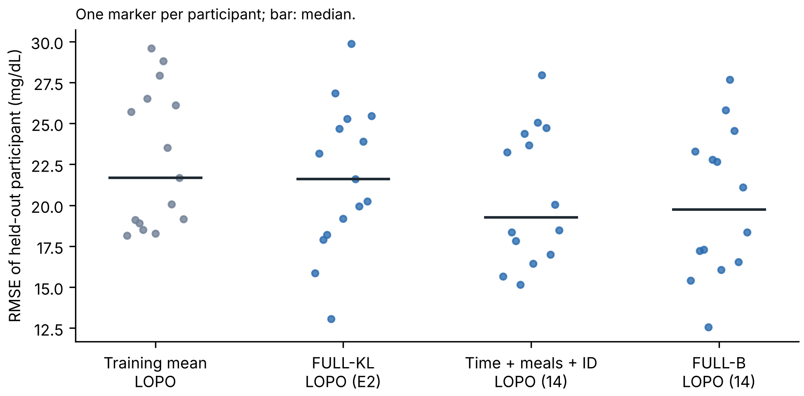
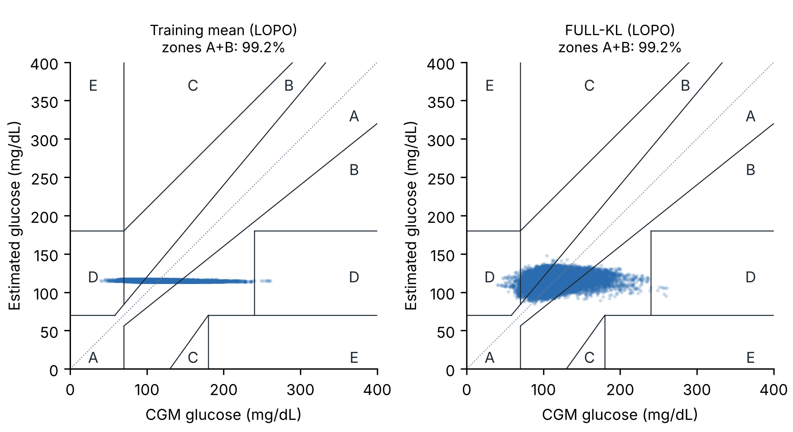
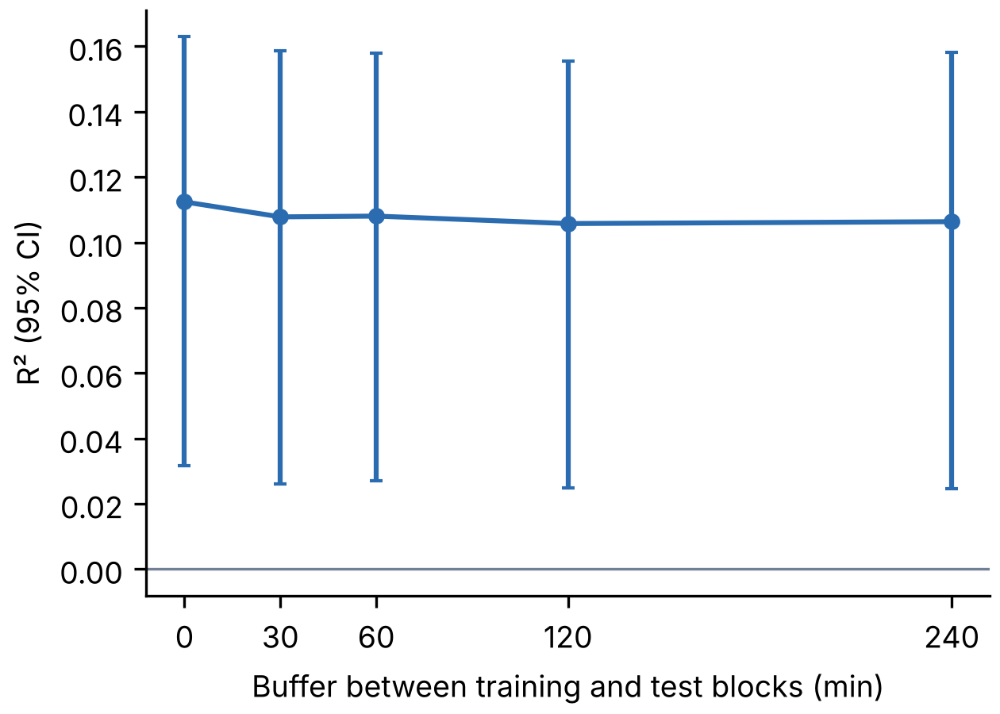
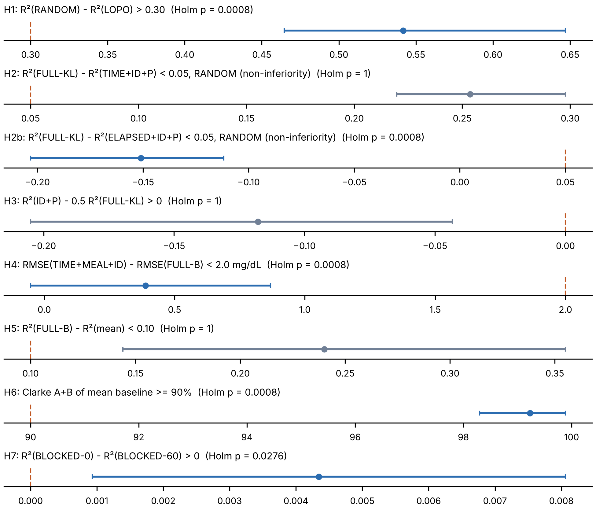
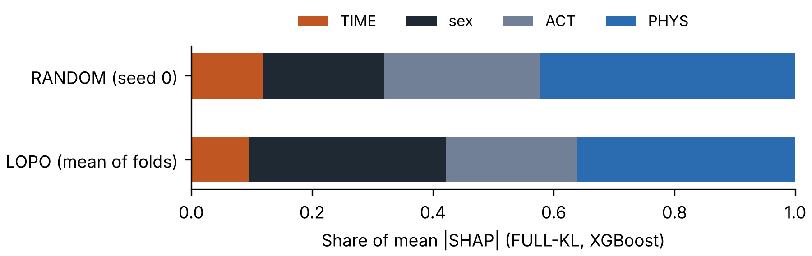

## 3. Results

Every number below is copied from a file written by the analysis code:
`results/experiments/` (registered analysis), `results/experiments_ea6/`
(sensitivity analysis EA6), `results/exploratory/` (EA1–EA5) and
`results/summary/` (tables). Intervals are two-sided 95% participant-bootstrap
intervals; *p* values are one-sided and Holm-corrected over the eight
registered tests. With 10,000 resamples the smallest attainable one-sided
*p* is 0.0001, which becomes 0.0008 after Holm correction.

### 3.1. Cohort and Readings

The 16 recordings held 36,898 CGM readings. Removing sensor warm-up left
36,266, and requiring usable E4 data in the preceding 5 min left 28,404
(Table 2). E4 coverage was all-or-nothing: readings without E4 data came
from periods when the band was not worn, not from partial signal loss.
Participant 015 kept 470 readings and was excluded by the data-integrity
rule, so the registered analyses used 27,934 readings from 15 participants
(median 159 h of usable data per participant; range 111–196 h), and 26,135
readings from 14 participants in the experiments with MEAL features. Glucose
in the analysed readings was 114.7 ± 22.9 mg/dL (mean ± SD); 0.6% of
readings were below 70 mg/dL and 1.5% above 180 mg/dL. EDA features were
valid in a median of 98% of readings per participant (range 71–100%).
Pulse-rate and heart-rate-variability features were valid far less often,
in a median of 28% of readings (range 15–52%), because the E4 drops
inter-beat intervals during movement.

**Table 2.** Readings per participant before and after each exclusion.

TABLE2_PLACEHOLDER

### 3.2. E1: Re-Implementation Under a Random Split

Under the published random 80/20 split, FULL-KL reached a mean R² of 0.613
over the 20 seeds (SD 0.014; range 0.582–0.635). Pooled over seeds, R² was
0.612 (95% CI 0.539–0.664), RMSE 14.3 mg/dL (13.0–15.9), MARD 8.9% and
Clarke zones A + B 99.4% (Table 3). The published values are R² = 0.73, RMSE
11.9 mg/dL and 99.4% in zones A + B [@karunarathna_glucose_2025]. The mean
R² was below the registered threshold of 0.63, so by the registered rule the
published R² was *not* approximately reproduced; the published Clarke
percentage was matched exactly. FULL-KL had 28 candidate features, fewer
than the 30 that the selection step keeps, so the selection step retained
all of them in every fold, as the registration specified. The lower
one-sided 95% bound of the E1 R² was 0.550, above the registered guard of
0.30, so H2, H2b and H3 are interpretable.

**Table 3.** Pooled performance of every registered configuration (95% CI).

TABLE3_PLACEHOLDER

### 3.3. E2: Random Versus Leave-One-Participant-Out

Holding participants out reduced the FULL-KL R² to 0.071 (−0.062 to 0.156)
and raised the RMSE to 22.1 mg/dL (19.7–24.3). The drop in R² was 0.542
(0.465–0.647), and its lower bound exceeded the registered margin of 0.30
(Holm *p* = 0.0008): **H1 was supported** (Table 4). Ridge regression gave
the same picture (LOPO R² 0.059, −0.079 to 0.154). Per participant, FULL-KL
had a lower RMSE than the training-mean baseline for 11 of 15 held-out
participants, but its R² around each participant's own mean was negative
for 9 of 15 (Figure 3). The LOPO RMSE of 22.1 mg/dL is close to the 21.2 ±
4.1 mg/dL that Bent et al. reported under the same scheme
[@bent_digital_2021].

**Table 4.** Registered tests (primary analysis, 15 participants; 14 for H4
and H5).

TABLE4_PLACEHOLDER

### 3.4. E3: Shortcut-Only Models

A model that knew only the participant, their sex and HbA1c, and the minutes
elapsed since their first CGM reading (ELAPSED+ID+P) reached R² = 0.763
(0.717–0.797) and RMSE = 11.2 mg/dL (10.3–12.0) under the random split. This
is higher than FULL-KL by 0.151 (0.112–0.203), and its RMSE is below the
published 11.9 mg/dL. The registered non-inferiority test therefore passed
by a wide margin (Holm *p* = 0.0008): **H2b was supported**. The same model
with clock time in place of elapsed time (TIME+ID+P) reached R² = 0.359
(0.259–0.434), 0.254 (0.220–0.298) below FULL-KL, so **non-inferiority was
not established for H2** (Holm *p* = 1.0). Identity alone (ID+P) reached R²
= 0.188 (0.081–0.279), less than half of the FULL-KL R² (difference −0.118,
−0.205 to −0.043): **H3 was not supported** (Holm *p* = 1.0). The leakage
under random splits therefore comes from knowing *where in a participant's
recording* a reading lies, not from the time of day or from identity
alone.

### 3.5. E4: What Wrist Physiology Adds

In the 14 participants with aligned food logs, held out one at a time, the
training-mean baseline had R² = −0.033 (−0.116 to −0.018) and RMSE = 23.5
mg/dL. Time, meals, sex and HbA1c (TIME+MEAL+ID) reached R² = 0.177
(0.082–0.243) and RMSE = 21.0 mg/dL (18.7–23.1). Adding wrist physiology and
activity (FULL-B) gave R² = 0.208 (0.099–0.279) and RMSE = 20.6 mg/dL
(18.1–22.9). Physiology and activity reduced the RMSE by 0.39 mg/dL (−0.05
to 0.87); the upper bound lay below the registered margin of 2.0 mg/dL
(Holm *p* = 0.0008), so **H4 was supported**. FULL-B had the lower RMSE for
11 of 14 participants, with per-participant differences from −1.1 to +2.6
mg/dL. FULL-B exceeded the baseline R² by 0.240 (0.144–0.355), which is more
than the registered margin of 0.10, so **H5 was not supported** (Holm *p* =
1.0). Most of that gain did not need the wristband: TIME+MEAL+ID alone
exceeded the baseline by 0.210 R² (point estimates). With ridge regression,
FULL-B reached R² = 0.154 (−0.031 to 0.277).

### 3.6. E5 and E6: Clarke Grid and Temporal Leakage

A constant prediction, the training-fold mean, placed 99.2% (98.3–99.9) of
held-out readings in Clarke zones A + B (Figure 4), so **H6 was supported**
(Holm *p* = 0.0008). Every configuration in the study, from the constant to
the leaky ELAPSED+ID+P model, placed between 99.2% and 99.6% of readings in
zones A + B (Table 3). Zone A alone separated them more: 70.4% for the
constant under LOPO, 74.9% for FULL-KL under LOPO, 90.7% for FULL-KL under
the random split and 95.3% for ELAPSED+ID+P.

Under contiguous blocks with no buffer (BLOCKED-0), FULL-KL inputs without
sex reached R² = 0.112 (0.032–0.163), against 0.108 (0.027–0.158) with a
60-min buffer. The difference of 0.0043 (0.0009–0.0081) was above zero (Holm
*p* = 0.028), so **H7 was supported**, but it is about one hundredth of the
drop between random and LOPO evaluation. Longer buffers changed R² by less
than 0.01 (Figure 5). Splitting each recording into contiguous blocks
therefore removed almost all of the leakage that the random split allows;
the buffer around the test block added little.

### 3.7. Sensitivity and Exploratory Analyses

**Sensitivity analysis EA6 (pre-specified).** With participant 015
included (16 participants, 28,404 readings; E4 unchanged at 14), every
registered verdict was the same as in the primary analysis except one
(Table S1). H7 was no longer supported: the R² difference between BLOCKED-0
and BLOCKED-60 was 0.0021 (−0.0016 to 0.0062; Holm *p* = 0.58). All other
estimates moved by less than 0.01 in R², and H1, H2b, H4 and H6 kept Holm
*p* = 0.0008.

**Table S1.** Registered tests in the primary analysis and in the
pre-specified sensitivity analysis EA6 (participant 015 included).

TABLES1_PLACEHOLDER

The remaining analyses are exploratory. They were specified in one line
each in the registration (§9); their details were fixed in code before any
registered result existed (Appendix B). They are not corrected for
multiplicity and carry no verdicts.

**EA5: FULL-KL without sex.** Sex was the most important feature in the
published model [@karunarathna_glucose_2025]. Without it, FULL-KL under
LOPO reached R² = −0.011 (−0.099 to 0.040) and RMSE = 23.0 mg/dL, against
R² = 0.071 with sex (difference −0.082, −0.163 to 0.017). Under LOPO, the
small amount of variance that FULL-KL explained came largely from sex, a
group-level shift in mean glucose, rather than from the wrist signals.

**EA2: personalised models.** Trained on the first half of each
participant's own recording and tested on the second half, XGBoost on
physiology, activity and time (PHYS+ACT+TIME) reached R² = 0.141
(−0.036 to 0.242) and RMSE = 21.8 mg/dL. Predicting each participant's own
first-half mean did as well (R² = 0.142, −0.024 to 0.260; difference in
RMSE 0.02 mg/dL, −0.90 to 1.03). Even within a person, and without the
leakage of a random split, the wrist signals added nothing to the person's
mean.

**EA3: CGM reliability ceiling.** If the CGM's error against blood glucose
is multiplicative and normally distributed with the Dexcom G6's overall
MARD of 10% [@wadwa_g6_2018], about 41% of the variance of the analysed CGM
readings is sensor error. A model that knew blood glucose exactly would
then reach R² ≈ 0.59 against the CGM (0.49 around each participant's own
mean). The E1 R² (0.61) is at this ceiling and the ELAPSED+ID+P R² (0.76)
is above it. Under these assumptions, models scored on a random split must
be reproducing part of the CGM's own error, which is correlated over
minutes, rather than glucose alone. The assumptions are strong: part of the
G6's MARD reflects the physiological lag between blood and interstitial
glucose, which would raise the ceiling for an interstitial target.

**EA4: E4 without meal features, and with 016's food log shifted.** On all
15 participants and without MEAL features, physiology and activity
(PHYS+ACT+TIME+ID) reached R² = 0.087 (−0.033 to 0.170), against 0.000
(−0.133 to 0.094) for time and identity alone; the RMSE gain was 1.02 mg/dL
(0.26–2.01). When meals are not logged, the wrist signals therefore recover
some of what meal timing provides, but only about half of the registered
2-mg/dL margin. Adding participant 016 with its food log shifted by −3 h
(15 participants) left the E4 result unchanged: FULL-B reached R² = 0.189
(0.087–0.264), and physiology and activity reduced the RMSE by 0.44 mg/dL
(0.07–0.91) relative to TIME+MEAL+ID.

**EA1: SHAP attribution.** Sex had the largest mean absolute SHAP value
under both schemes: 20% of the total attribution of FULL-KL under the random
split (seed 0) and 33% under LOPO (mean over folds), in line with the
published model [@karunarathna_glucose_2025]. Under the random split the
rest of the attribution was spread over slowly varying inputs: the 2-h
activity summaries, mean skin temperature and minutes from midnight each
carried 5–6%. Summed by group, physiology carried 42% and activity 26% under
the random split, against 36% and 22% under LOPO (Figure 7). Attribution
shows what a model uses, not why: an input that changes slowly within a
recording can locate a reading in time as well as reflect physiology.

